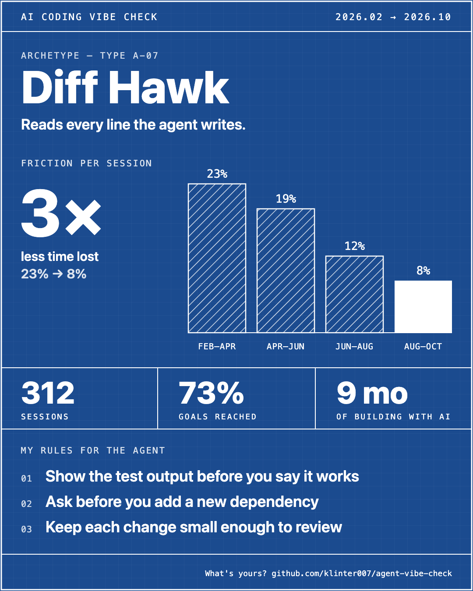
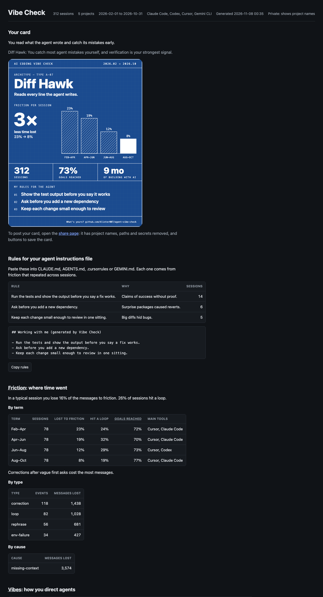

# Agent Vibe Check

**How well do you direct AI coding agents?** Agent Vibe Check reads your local chat history from Cursor, Claude Code, Codex and Gemini CLI. It shows where your sessions lose time, how that changed over the months, and the rules your agent should follow so the same problems stop coming back.

<p align="center">
  
</p>

<p align="center"><em>Example card. All data on this page is made up.</em></p>

## Run it

```bash
uvx --from git+https://github.com/klinter007/agent-vibe-check vibe-check
```

No `uv`? Use `pipx run --spec git+https://github.com/klinter007/agent-vibe-check vibe-check`, or clone the repo and run `pip install -e .` then `vibe-check`.

You need Python 3.10+ and one AI to do the review. The first screen asks which AI tools you use and asks permission for each one before it reads anything.

| Reviewer | What you need |
|---|---|
| Claude (default, supports cheaper batch mode) | `ANTHROPIC_API_KEY` |
| OpenAI (GPT) | `OPENAI_API_KEY` |
| xAI (Grok) | `XAI_API_KEY` |
| OpenRouter (hundreds of models) | `OPENROUTER_API_KEY` |
| Groq | `GROQ_API_KEY` |
| Gemini | `GEMINI_API_KEY`, and add `--with google-generativeai` to the `uvx` command |
| A local model: Ollama, LM Studio, vLLM | Nothing. The server runs on your machine. |

For every reviewer except Claude and Gemini, the tool asks the server for its model list and you pick one once. Any server that speaks the OpenAI chat completions API works: choose "Other OpenAI-compatible server" and give its URL. Pick a strong, recent model: weak models give vague reviews.

## Your data stays yours

- **Nothing is uploaded to me or to any server of this project.** There is no backend, no account, no telemetry, no analytics. I never see your data, your results or your card.
- **Your transcripts go to one place only: the AI you choose to do the review, with your own key.** That provider's data terms apply. **With a local model (Ollama, LM Studio), nothing leaves your machine at all.** Before a transcript is sent, the tool removes common key and token formats, private keys, passwords and credentialed URLs from it. This is best effort: a secret in an unusual format can get through. If that is not OK for some projects, turn off that tool in onboarding, or do not run the tool.
- **All results stay on your machine**, in `~/.vibe-check/` (or `$VIBE_CHECK_HOME` if you set it). Delete that folder and everything is gone. In batch mode, Anthropic also keeps the batch results on its side for a limited time under its data terms.
- **Read-only.** The tool reads your chat history and runs `git log` in your project folders. It never changes them.
- **You decide what to share.** The private report shows your project names. The share export (`~/.vibe-check/atlas/share/`) replaces them with "Project A, B, ..." and removes your name, keys, tokens, emails, paths, IPs and common hostnames. A last scan blocks the export if anything private is left. Look at it before you post: a tool cannot know every name that matters to you.

## Share your card

Open `~/.vibe-check/atlas/share/index.html` (the redacted page) and click **Save PNG**. The card is 1080x1350, the size LinkedIn and Instagram show without cropping; it works on X and Threads too.

If you post it, tag me so I can see it: **X [@GiliBenShahar](https://x.com/GiliBenShahar)** or **Instagram [@gilibenshahar](https://www.instagram.com/gilibenshahar/)**. I would love to see what type you got.

## Tell me what you think

Something wrong, unclear or missing? A type that does not fit you? Open an [issue](https://github.com/klinter007/agent-vibe-check/issues). Ideas and pull requests are welcome, especially new chat sources.

---

## What you get

| Output | What it is |
|---|---|
| **Card** | A 1080x1350 "spec sheet": your type, how much of a session you lose to friction in each term, sessions, goals reached, time span, and your top 3 rules. Save as PNG or SVG. |
| **Rules** | Up to 8 rules for your agent instructions file, each backed by friction that repeated across sessions. Copy button included. |
| **Friction** | Where time went: loops, corrections, rephrased asks, tool failures. Share of a typical session lost, by term, type and cause. |
| **Vibes** | Six signals of how you direct agents, in the report (not on the card), with the change over time. |
| **Agents compared** | Cursor vs Claude Code vs Codex vs Gemini CLI for you: goals reached, friction per session, most common task. |
| **Projects** | What each project is, outcomes, what worked, what kept going wrong, project-specific rules. |
| **Share export** | The same card and page with project names, paths, hosts, emails and secrets removed. |

### The six signals ("Vibes")

The agent writes most of the code now, so Vibe Check does not grade your Python. It grades how you direct the agent:

| Signal | Question |
|---|---|
| Specification | Do you say what done looks like before the work starts? |
| Context | Does the agent get what it needs, or does it guess? |
| Verification | Do you check the result, or trust "done"? |
| Steering | When the agent goes wrong, how fast and how clearly do you correct it? |
| Delegation | Is the work cut into pieces the agent can do and you can check? |
| Learning loop | Do lessons stick, or does the same correction come back? |

Only sessions where you typed the prompts are scored. Sessions that another agent drove (orchestrators, worker panes, agent-to-agent rounds) are counted but never scored: this is your vibe check, not your agents'.

### Outcomes

Each session gets `shipped`, `partial`, `abandoned` or `unknown`, from what the transcript shows (confirmed working, tests pass, commit, PR, revert, gave up) plus the local `git log` of the project around the session. Thin evidence stays `unknown`; it never guesses.

### Archetypes

Blueprint Brain, Receipt Keeper, Loop Breaker, Speedrunner, Night Shift Pilot, Context Hoarder, Diff Hawk, Vibe Surfer, Guardrail Builder, Prompt Sculptor, Bug Detective, Sandbox Scientist. Each is a fixed formula over measured numbers (what stands out in your own signals, how often you run agent crews, your task mix, loops, the share of agent mistakes you catch), so two people's cards are comparable and a card can only show a type the data supports. With fewer than 10 sessions you typed, or too little evidence, the card says **Warming Up** instead of guessing.

---

## Supported tools

| Tool | Where it reads |
|---|---|
| Cursor | `~/.cursor/projects/*/agent-transcripts/` and Cursor's `workspaceStorage/*/state.vscdb` |
| Claude Code | `~/.claude/projects/*/*.jsonl` (`$CLAUDE_CONFIG_DIR` respected) |
| Codex (OpenAI) | `~/.codex/sessions/**/rollout-*.jsonl` (`$CODEX_HOME` respected) |
| Gemini CLI | `~/.gemini/tmp/*/chats/session-*` |

On first run Vibe Check shows what it found for each tool, asks which one you use most, and asks permission per tool. Nothing is read before you say yes. Change it later in **Settings -> Sources**.

Skipped on purpose: sessions started by scripts (Claude Agent SDK, `codex exec`), subagent threads, and sessions started in temp folders. Those are agents talking to agents.

One project used from two tools is merged into one project, by working directory.

---

## A full run

Dependencies: `rich` and `anthropic`. Gemini support is an optional extra (`pip install "agent-vibe-check[gemini]"`); every OpenAI-compatible reviewer needs no extra package. The tool asks for an API key if it cannot find one and can save it to `~/.vibe-check/config.json` (readable only by you).

Pick **5. Full pipeline**:

1. Scope: all sessions, or **Quick** (10 most recent per project) for a cheap first look.
2. **Batch mode** (Claude only): 50% cheaper, results usually within an hour.
3. You see the session count and a cost range before anything is sent.

### How many tokens

Measured on a real history of about 1,200 sessions from four tools:

| | Per session | 1,000 sessions |
|---|---|---|
| Input | about 10,000 tokens | about 10 million |
| Output | about 2,000 tokens | about 2 million |

What that costs depends on your plan and model, so the tool shows the session count and token estimate before anything is sent. Quick mode (10 most recent sessions per project) is a cheap first look. Claude batch mode halves the price. Re-runs only review new or changed sessions.

---

## Output

Everything lives under `~/.vibe-check/` (override with `$VIBE_CHECK_HOME`).

```
~/.vibe-check/
  atlas/
    dashboard.html      private report (shows project names)
    PROFILE.md          the same in markdown
    RULES.md            paste-ready rules block
    profile.json        Stage 5 data
    share/
      card.svg          redacted card
      index.html        redacted page
      RULES.md
  extractions/<project>/
    sessions/<id>.json  Stage 1 review per session
    project.json        Stage 2 synthesis
    PROJECT.md          per-project report
  config.json           keys, model, enabled sources (0600)
```

### The private report

<p align="center">
  
</p>

---

## How it works

```
Stage 1  session review     transcript      -> vibes, friction, outcome, rules  (LLM, per session, batchable)
Stage 2  project synthesis  session reviews -> project story + counts           (LLM, per project)
Stage 3  timeline           session reviews -> monthly / quarterly trend         (local + 1 LLM call)
Stage 4  cross-project      projects        -> where your scores differ          (local + 1 LLM call)
Stage 5  profile            everything      -> archetype, card, merged rules     (local + 1 LLM call)
```

Every stage writes atomically and caches on content fingerprints. Ctrl-C once stops cleanly; the next run picks up where it stopped. Scores, counts and the archetype are computed locally; the LLM only does judgment and writing. Every score cites message numbers from the transcript.

---

## Contributing

```bash
pip install -e ".[dev]"
pytest -q
```

All tests are hermetic: no Cursor or Claude Code install, no live LLM calls. Adding a source: one module in `agent_vibe_check/sources/` that yields `Session` objects, plus fixtures in `tests/test_sources.py`.

## License

MIT, see [LICENSE](LICENSE). Brand icons for Cursor, Claude and Gemini come from [Simple Icons](https://simpleicons.org) (CC0); the trademarks belong to their owners.
